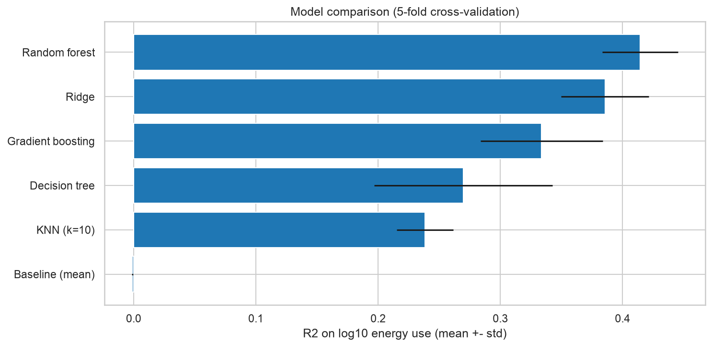
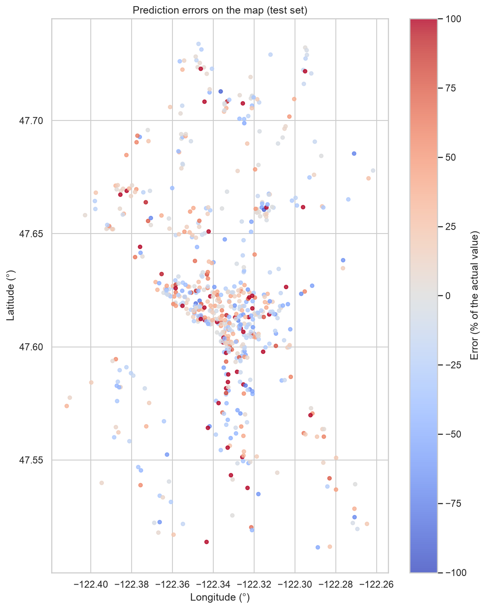

# Seattle buildings: predicting energy use per m2

Chloe Hraibeh, Jeff El Khoury, Luca Obejdeanu
AI Methods I, Day 2 (supervised learning), IAAC MaAI 2026/27

**Model on Hugging Face:** https://huggingface.co/iaac-maai/day2-team6-energy-use

## Use case

An architect doing a feasibility study for a new building in Seattle wants a first idea of its yearly energy use per m2, before anything is designed in detail. They only know the use, the size, the number of floors, the year and the location. The costly mistake is underestimating: the bills end up higher and the building can miss the city's energy targets.

## Dataset

| | |
|---|---|
| Name | 2016 Building Energy Benchmarking (Seattle) |
| Source | Kaggle, [city-of-seattle/sea-building-energy-benchmarking](https://www.kaggle.com/datasets/city-of-seattle/sea-building-energy-benchmarking) |
| Cleaning | in our [Day 1 repo](https://github.com/iaac-maai/6-day1-assignment) |
| One row | one building |
| Rows used | 3,211 (train 2,568, test 643) |
| Licence | Public Domain |

## Repo

```
data/         seattle_buildings_clean.csv (the clean table from Day 1)
figures/      plots exported by the notebook
models/       README.md = the model card (+ its 2 figures), model.joblib is only on Hugging Face
notebook/     supervised_learning.ipynb
.gitignore
LICENSE
README.md
requirements.txt
```

## How to run

```bash
python -m venv .venv
source .venv/bin/activate        # Windows: .venv\Scripts\activate
pip install -r requirements.txt
```

Open `notebook/supervised_learning.ipynb`, select `.venv` and run all. The notebook reads the clean table from our Day 1 repo (fixed to one commit), saves a copy in `data/`, the plots in `figures/` and the trained model in `models/model.joblib`.

## Approach

- **Target:** `site_eui_kwh_m2` (energy per m2 in a year), regression, on a log10 scale because it's very skewed.
- **Metrics:** we compare and tune the models with R2 on the log scale. We also report the MAE as a typical % error and check how often the model underestimates.
- **Features (11):** use, city building type, neighborhood, latitude, longitude, year built, floors, number of buildings, floor area, area per floor, parking share.
- **Removed:** all the energy, gas and emissions columns and the ENERGY STAR score, because they come from the same bills as the target (leakage). Also `has_gas`: it comes from the gas bills too, so we only tested it in a separate experiment.
- **Preprocessing:** one `Pipeline` with a `ColumnTransformer`. Numbers: median for missing values, then scaling (only for Ridge and KNN). Categories: most common value for missing ones, then one-hot, since they have no order.
- **Models:** baseline (mean), Ridge, KNN, decision tree, random forest, gradient boosting. 5-fold cross-validation on the training set, same folds for all. Then a validation curve on `max_depth` and a `GridSearchCV` on the random forest.

## Results

Cross-validation on the training set:

| Model | R2 (mean +- std) | Typical error |
|---|---|---|
| Baseline (mean) | 0.00 +- 0.00 | 65% |
| KNN (k=10) | 0.24 +- 0.02 | 51% |
| Decision tree | 0.27 +- 0.07 | 50% |
| Gradient boosting | 0.33 +- 0.05 | 47% |
| Ridge | 0.39 +- 0.04 | 46% |
| Random forest | 0.41 +- 0.03 | 44% |



**Final model:** the tuned random forest (`max_features=0.3`, `min_samples_leaf=1`, CV R2 0.421 against 0.414 with the default settings). The gap with Ridge is small, but it's the best score. If the model had to be fast, light or easy to explain, Ridge would be the better choice: it trains in 0.01 s instead of 1.6 s, and the saved forest is 47 MB.

**Test set (used once):**

| | Random forest | Baseline |
|---|---|---|
| R2 (log10) | 0.39 | - |
| Typical error | 45% | - |
| MAE | 68 kWh/m2 | 89 kWh/m2 |
| RMSE | 167 kWh/m2 | - |
| MAPE | 47% | - |

- 49% of the test buildings are underestimated, 7% by more than half.
- It works best for housing (median error 16-21%) and worst for warehouses and "Other" (around 50%).
- It mostly relies on the use of the building, then the building type and a bit on the year built.
- With `has_gas` the R2 would go up by about 0.05, but it comes from the bills so the final model doesn't use it.




## Limitations

- R2 0.39: it explains less than half of the differences. Energy depends a lot on how the building is used (hours, equipment, people), which isn't in the data.
- It pulls predictions towards the middle, so it underestimates the buildings that use the most.
- Only big buildings, only Seattle, only 2016.
- The split is random, so we test on existing buildings, not on buildings built later.
- Self reported data.
- Not for data centers, labs or very mixed buildings, or as an exact number for a design decision.

## AI usage

| | |
|---|---|
| Tools | Claude Code (agent) |
| Why | to go faster with the code and to have something to ask every time we didn't get a step |
| Where | the pipeline code, the plots, the first drafts of the texts, the model card and this README |
| How | we went through every cell asking why. For example: "isn't this error huge?". We ran everything again ourselves at the end |

Lessons learned: in the first version the AI used `has_gas` as an input and explained it as a design choice, and it sounded right. Chloe noticed it actually comes from the gas bills, so it's leakage, and we took it out. The explanation sounding good doesn't mean it's right, you have to check where every input comes from yourselves.

## License

MIT for the code and the model, the data is public domain.
