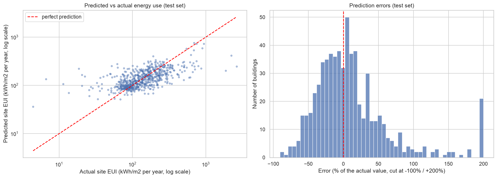

# Seattle building energy use: predicting energy per m2 from building characteristics

This model predicts the yearly energy use per m2 (site EUI, in kWh/m2) of a building in Seattle from things you know before it's built: its use, the city building type, size, number of floors, year and location. It's a scikit-learn pipeline (preprocessing + random forest) trained on about 2,600 buildings from Seattle's 2016 building energy report. It was made as a course assignment for AI Methods I (IAAC MaAI 2026/27).

- **GitHub repository (full pipeline):** https://github.com/iaac-maai/6-day2-assignment
- **Team:** Chloe Hraibeh, Jeff El Khoury, Luca Obejdeanu

## Intended use

- **Intended users and use:** architects and students who want a first, rough idea of the energy use of a new building during a feasibility study, or want to see how the use of the building changes the estimate. It's a teaching model.
- **Out-of-scope uses:**
  - any real decision that needs an exact number (energy certificates, cost calculations, compliance with energy targets)
  - cities other than Seattle (different climate, different electricity)
  - small buildings: the data only has buildings over 20,000 sqft (about 1,860 m2)
  - data centers, labs and very mixed buildings, where the errors are very big
  - values outside the training range: roughly 4 to 2,600 kWh/m2 per year

## Model details

| | |
|---|---|
| **Problem type** | Regression |
| **Target** | `log10(site_eui_kwh_m2)` |
| **Algorithm** | `RandomForestRegressor` |
| **Key hyperparameters** | `n_estimators=200`, `max_features=0.3`, `min_samples_leaf=1`, `random_state=42` (tuned with `GridSearchCV`) |
| **Preprocessing** | numeric: median imputation + scaling. Categories: most frequent value imputation + one-hot encoding (`handle_unknown="ignore"`) |
| **File** | `model.joblib`: the whole fitted scikit-learn `Pipeline` (preprocessing + model), saved with `joblib` |
| **Library versions** | Python 3.12, scikit-learn 1.9.1, pandas 3.0.6, numpy 2.5.3, joblib 1.6.0 |

## Input features

The model expects a `pandas.DataFrame` with exactly these 11 columns. Missing values (NaN) are allowed, they are filled like in training. Unknown categories are ignored.

| Column | Type | Unit | Description | Preprocessing |
|---|---|---|---|---|
| `primary_property_type` | category | - | main use, e.g. `"Low-Rise Multifamily"`, `"Small- and Mid-Sized Office"`, `"Hotel"`, `"Warehouse"` | one-hot |
| `building_type` | category | - | city category: `"Nonresidential"`, `"Multifamily LR (1-4)"`, `"Multifamily MR (5-9)"`, `"Multifamily HR (10+)"`, `"Campus"`, `"SPS-District K-12"` | one-hot |
| `neighborhood` | category | - | Seattle neighborhood in capitals, e.g. `"DOWNTOWN"`, `"EAST"`, `"BALLARD"` | one-hot |
| `year_built` | integer | year | year of construction | median imputation, scaling |
| `number_of_floors` | integer | floors | number of floors | median imputation, scaling |
| `number_of_buildings` | integer | count | buildings on the property (usually 1) | median imputation, scaling |
| `gfa_m2` | float | m2 | gross floor area of the buildings, without parking | median imputation, scaling |
| `gfa_per_floor_m2` | float | m2 | `gfa_m2 / number_of_floors`, roughly the footprint | median imputation, scaling |
| `parking_share` | float | 0-1 | part of the total area that is parking | median imputation, scaling |
| `latitude` | float | degrees | location | median imputation, scaling |
| `longitude` | float | degrees | location | median imputation, scaling |

## Output

The model returns **log10 of the site EUI** (energy per m2 per year). To get kWh/m2 per year: `10 ** prediction`.

## Training data

| | |
|---|---|
| **Dataset** | 2016 Building Energy Benchmarking (Seattle) |
| **Source** | [kaggle.com/datasets/city-of-seattle/sea-building-energy-benchmarking](https://www.kaggle.com/datasets/city-of-seattle/sea-building-energy-benchmarking) |
| **Licence** | Public Domain (City of Seattle) |
| **One row is** | one building (or property) in 2016 |
| **Size used** | 3,211 buildings (train 2,568, test 643) |
| **Coverage** | Seattle, 2016, non-residential and multifamily buildings over 20,000 sqft |

**Cleaning** (in our [Day 1 repository](https://github.com/iaac-maai/6-day1-assignment)): removed the 165 buildings the city marks as not compliant, fixed the spelling of neighborhoods and building types, set impossible values (0 floors, 0 buildings, a 99-floor church) to NaN, converted everything to m2 and kWh, and created new columns like `gas_share` and `gfa_per_floor_m2`.

**Leakage:** the metered energy columns, the emissions, `gas_share` and the ENERGY STAR score all come from the same energy bills as the target, so they are not inputs. A yes/no `has_gas` column also comes from the gas bills (gas actually used, not the heating system planned), so it's not an input either, we only tested it in a separate experiment.

## Training procedure

- **Split:** 80 / 20 train / test, `random_state=42`. The test set was used once, at the end.
- **Validation:** 5-fold cross-validation (`KFold`, shuffled, `random_state=42`) on the training set, with all preprocessing inside the pipeline.
- **Models compared** (same folds, R2 on log10 of the energy use):

| Model | CV R2 (mean +- std) | Typical error |
|---|---|---|
| Baseline (always predicts the mean) | 0.00 +- 0.00 | 65% |
| KNN (k=10) | 0.24 +- 0.02 | 51% |
| Decision tree (max_depth=8) | 0.27 +- 0.07 | 50% |
| Gradient boosting (default) | 0.33 +- 0.05 | 47% |
| Ridge | 0.39 +- 0.04 | 46% |
| Random forest (200 trees) | 0.41 +- 0.03 | 44% |

- **Gas experiment:** adding `has_gas` raises the R2 to 0.47 (random forest) and 0.44 (Ridge). It helps, but since it comes from the bills the final model doesn't use it.
- **Tuning:** validation curve on `max_depth` (no gain after depth 15), then `GridSearchCV` on `min_samples_leaf` (1, 3, 5, 10) and `max_features` (0.3, 0.5, 1.0). Best: `max_features=0.3`, `min_samples_leaf=1`, CV R2 0.421 (0.414 with default settings).
- **Why this model:** best score, even if the gap with Ridge is small. Ridge would be the better choice if the model had to be fast, light or easy to explain: it trains in 0.01 s instead of 1.6 s, and the saved forest is 47 MB.

## Evaluation

Results on the held-out **test set** (643 buildings, used once):

| Metric | Test | Cross-validation |
|---|---|---|
| R2 on log10 energy use | **0.39** | 0.42 |
| Typical error | **45%** | - |
| MAE | **68 kWh/m2** | - |
| RMSE | 167 kWh/m2 | - |
| MAPE | 47% | - |
| Buildings within +-20% | 41% | - |

The baseline that always predicts the average has an MAE of 89 kWh/m2.

The model underestimates about half of the buildings (49%), but that alone doesn't mean it's balanced: 7% are underestimated by more than half. It pulls everything towards the middle: buildings that use very little get overestimated and the ones that use a lot get underestimated.



**Where it performs worst:** "Other" (median error 52%) and warehouses (49%), very mixed groups. It works best for housing (16-21%). By neighborhood it overestimates Ballard and Southeast (around +20%) and underestimates Central (around -17%) and Delridge, Southwest and Greater Duwamish (around -10%).


**What it relies on** (permutation importance on the test set): mostly the use of the building, then the building type, and a bit the year built. Size and location almost nothing.

## Limitations and biases

- It only explains about 39% of the differences in (log) energy use. The rest depends on how the building is used (opening hours, equipment, number of people), which isn't in the data.
- It underestimates the buildings that use the most energy, which is the costly mistake for someone planning a building.
- Only big buildings, only Seattle, only 2016.
- The train / test split is random, so the test buildings are existing buildings mixed with the training ones, not buildings built later. On really new buildings it could do worse.
- It knows nothing about the heating system. Gas helped in our experiment, but in this data we only have it from the bills.
- The data is reported by the owners, the city checks it but there can still be mistakes.
- Importance is not causation: a column the model uses isn't necessarily a cause of the energy use.

## How to use

```python
import joblib
import pandas as pd
from huggingface_hub import hf_hub_download

path = hf_hub_download(repo_id="iaac-maai/day2-team6-energy-use", filename="model.joblib")
model = joblib.load(path)

example = pd.DataFrame([{
    "primary_property_type": "Mid-Rise Multifamily",
    "building_type": "Multifamily MR (5-9)",
    "neighborhood": "EAST",
    "year_built": 2016,
    "number_of_floors": 6,
    "number_of_buildings": 1,
    "gfa_m2": 6000,
    "gfa_per_floor_m2": 1000,
    "parking_share": 0.1,
    "latitude": 47.615,
    "longitude": -122.315,
}])
prediction = model.predict(example)
print(f"{10 ** prediction[0]:.0f} kWh/m2 per year")
```

**Security note:** `.joblib` files are Python pickles and can run code when they are loaded, so only load models from sources you trust. Use the library versions listed above, the model may not load with other versions.

## Reproducibility

The full pipeline (loading the clean data, training, evaluation) is in the GitHub repository: https://github.com/iaac-maai/6-day2-assignment. Run `notebook/supervised_learning.ipynb` with the packages in `requirements.txt`.

## Authors and licence

Chloe Hraibeh, Jeff El Khoury, Luca Obejdeanu. Course assignment for **AI Methods I: Machine Learning for the Built Environment**, IAAC MaAI 2026/27.

Model released under the MIT License. The training data is Public Domain (City of Seattle).
